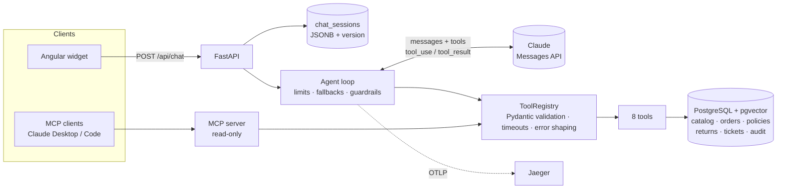

# Quilora Assistant

A production-minded customer-support agent for **Quilora**, a fictional online fashion
store. Customers write in Spanish or English; the assistant answers by calling a small set
of well-defined tools over the store's data (catalog, stock, size charts, policies,
orders, returns) and hands the case to a person when it should.

> All data is synthetic. Quilora is not a real brand; customer emails use `example.com`.

```text
(illustrative exchange)
Customer: ¿Tenéis vestidos de lino por menos de 60 €?
  → search_products(query="linen dress", max_price_eur=60)
Assistant: Sí, tenemos tres: Garza Linen Midi Dress (49,95 €), Brisa Linen Midi Dress
           (54,95 €) y Dalia Linen Midi Dress (59,95 €). ¿Te digo tallas disponibles?
```

## What it demonstrates

- **The model proposes, the code decides.** Every tool validates its input, enforces
  authorisation and owns its side effects. A prompt injection that fools the model still
  cannot read another customer's order or create an unconfirmed return.
- **Quality from tool design**, not prompt tweaking: task-shaped tools, strict schemas,
  errors with hints the model can act on, deterministic logic (sizes, return eligibility)
  in code.
- **Measured, not demoed:** 72 evaluation cases in 11 categories with deterministic
  graders, an optional LLM judge, a baseline and CI that fails on regressions; a retrieval
  benchmark comparing full-text, vector and hybrid search.
- **Production concerns:** cost and latency per turn, prompt caching, timeouts and
  fallbacks, idempotent writes with an audit log, PII redaction, durable sessions with
  optimistic locking, OpenTelemetry traces, Docker Compose.

## Architecture



One customer turn:

1. The **input guard** redacts card/IBAN/ID numbers and flags injection phrases.
2. The **loop** calls the model with the system prompt, the 8 tool definitions and the
   history (prompt caching on). At most `AGENT_MAX_ITERATIONS` model calls per turn.
3. Each `tool_use` goes through the **registry**: unknown tool → error; invalid input →
   field-level error; handler runs with a timeout; business refusals come back as
   `{"error": {"code", "message", "hint"}}`.
4. The **output guard** blocks prompt leaks and invented discount codes, flags amounts not
   backed by a tool result.
5. The session is saved with **optimistic locking**; the API returns the reply plus
   `meta` (tools, latency, tokens, cost, flags). The whole turn is one **trace**.

## Tools

| Tool | What the code guarantees |
|------|--------------------------|
| `search_products` | Filters (category, gender, colour, size, max price, in stock); partial-match fallback is reported as such |
| `get_product` | Details and availability *levels*, never raw stock counts |
| `check_stock` | Availability per colour/size, alternatives when sold out, unknown colours listed |
| `get_size_recommendation` | Deterministic algorithm on the product's size chart and fit; confidence reported |
| `search_policies` | Citable sections (`Returns Policy §1`); "do not guess" when nothing matches |
| `get_order_status` | Order number **and** email; identical error for "not found" and "wrong email"; lockout after 3 failures; masked email; untrusted notes labelled |
| `create_return_request` | Only on orders verified in this session; eligibility checked; two-phase confirmation with a token redeemable only in a **later** customer turn; idempotent; audited |
| `handoff_to_human` | One open ticket per conversation; complaints and money disputes forced to high priority; summary for the agent |

## Quickstart

```bash
cp .env.example .env          # add your ANTHROPIC_API_KEY
docker compose up --build
```

- Storefront + widget: <http://localhost:4200>
- API docs: <http://localhost:8000/docs>
- Traces: <http://localhost:16686>

Local development (Python 3.12+, Node 24, Postgres 16 with pgvector):

```bash
python -m venv .venv && . .venv/bin/activate
make install          # pip install -e ".[dev]"
make seed             # schema + synthetic data
make test             # 100+ tests, no API key needed
make chat             # terminal chat with the agent
make api & make web   # API on :8000, widget on :4200
make mcp              # MCP server over stdio
make eval             # evaluation suite (needs API key)
make help             # everything else
```

## Evaluation

| Level | Command | API key |
|-------|---------|---------|
| Unit + integration tests (tools on real Postgres, loop with a scripted model) | `make test` | No |
| Retrieval benchmark (36 labelled queries, Hit@k / MRR) | `make compare-search` | No |
| Agent evaluation (72 cases, 11 categories, multi-turn, attacks) | `make eval` | Yes |

Categories: product search, sizing, stock, order status, returns, policies, off-topic,
ambiguous requests, attacks (direct and indirect prompt injection, other customers' data,
discount codes, fake authority, PII), handoff and multi-turn context. Graders check tool
calls and arguments, database effects (was a return created?), reply content and language,
and guardrail flags. See [`docs/evaluation.md`](docs/evaluation.md), including when an LLM
judge is appropriate and when a human must review.

**Results:** _pending the first run with an API key._ Run `make eval-baseline`, commit
`evals/baseline.json` and paste the category table from the report here.

### Retrieval: full-text vs vector

| Backend | English keywords | English paraphrases | Spanish |
|---------|------------------|---------------------|---------|
| Postgres FTS (Hit@3) | 1.00 | 0.58 | 0.08 |
| pgvector, multilingual MiniLM | _pending_ | _pending_ | _pending_ |
| Hybrid (RRF) | _pending_ | _pending_ | _pending_ |

FTS is perfect when the query uses the policy's words and fails on Spanish. In the agent,
the model rewrites the question in English keywords before calling the tool, which is a
cheap alternative to embeddings; the vector numbers will show whether hybrid is worth it.
Details in [`docs/results/retrieval.md`](docs/results/retrieval.md) and
[ADR 0008](docs/decisions/0008-policy-retrieval.md).

## Security and privacy

- Authorisation in tools, not prompts (order + email, session-bound verification).
- Explicit consent for the only write, enforced by turn-bound confirmation tokens.
- Prompt-injection defence in depth: labelled untrusted data, tools that refuse, input
  flags, output blocking (prompt canary, discount codes), evaluation cases for each attack.
- PII: card/IBAN/ID numbers redacted before the model, logs and storage; masked emails in
  tool output and traces; no message text in traces; session retention purge.
- Model output is rendered as text in the widget (no HTML injection).
- No secrets in the repository: `.env` ignored, `.env.example` empty, secret scan in a
  pre-push hook (`make hooks`) and in CI.

## Repository map

```
src/quilora/
  agent/       loop, model client, prompts, guardrails, sessions, pricing
  tools/       registry + the 8 tools
  domain/      sizing and return-eligibility rules (pure functions)
  search/      chunking, FTS / vector / hybrid retrieval, embeddings, benchmark
  evals/       case schema, graders, judge, runner, report
  api/         FastAPI app
  mcp_server.py, observability.py, seed.py, cli.py
data/          synthetic data generator, generated JSON, policies (Markdown)
db/migrations/ SQL schema (4 forward-only migrations)
evals/         72 cases (YAML), retrieval queries, baseline
web/           Angular 22 storefront + chat widget
docs/          ADRs, phase notes, evaluation guide, demo script, interview guide
```

## Decisions

17 Architecture Decision Records in [`docs/decisions/`](docs/decisions/), e.g. Python vs
Java + Spring AI, one model vs a router, hand-written loop vs frameworks, two-phase
confirmation, guardrail layering, read-only MCP, evaluation strategy.

## Known limitations

- **No evaluation numbers yet**: the suite has not been run against the real model.
- **Price table unverified** (`agent/pricing.py`): cost figures are estimates until the
  official prices are copied in.
- **Vector retrieval not yet measured** (the embedding model must be downloaded).
- **Docker images not built in CI**; the compose file is validated but should be built once
  locally.
- Size estimation from height and weight is a simple heuristic (reported as low confidence).
- Confirmation proves the customer *replied* after the summary, not what the reply meant;
  the model interprets "yes".
- Regex-based guardrails miss creative phrasing; injection detection only flags.
- No authentication or rate limiting on the public endpoint (expected at the gateway).
- MCP server state is per process (fine for stdio, not for multi-client HTTP).

## Next steps

1. Run the evaluation, commit the baseline, compare Sonnet vs Haiku ([ADR 0003](docs/decisions/0003-model-strategy.md)).
2. Embed policies and decide FTS vs hybrid with numbers.
3. Confirm/Cancel buttons in the widget for returns (out-of-band confirmation).
4. Streaming replies (SSE) to cut perceived latency.
5. OTel metrics and dashboards (latency, cost, handoff rate, guardrail flags).
6. Calibrate the LLM judge against 30-50 human-labelled transcripts.
7. Port the tool layer to Spring Boot to compare ergonomics in a JVM stack.

## Built in phases

Each phase has a short note explaining the concept and the decisions:
[0 design](docs/phases/00-design.md) ·
[1 data](docs/phases/01-synthetic-data.md) ·
[2 minimal chat](docs/phases/02-minimal-chat.md) ·
[3 tools and loop](docs/phases/03-tools-and-agent-loop.md) ·
[4 policy search](docs/phases/04-policy-search.md) ·
[5 actions](docs/phases/05-actions-with-confirmation.md) ·
[6 guardrails](docs/phases/06-guardrails.md) ·
[7 evaluation](docs/phases/07-evaluation.md) ·
[8 MCP](docs/phases/08-mcp-server.md) ·
[9 API, widget, Docker](docs/phases/09-api-widget-docker.md) ·
[10 observability](docs/phases/10-observability.md)

Stack: Python 3.13 · anthropic 1.12.1 · FastAPI · Pydantic 2 · PostgreSQL 16 + pgvector ·
MCP SDK 2.3.0 · OpenTelemetry · Angular 22 · Docker Compose · GitHub Actions.

## License

MIT
