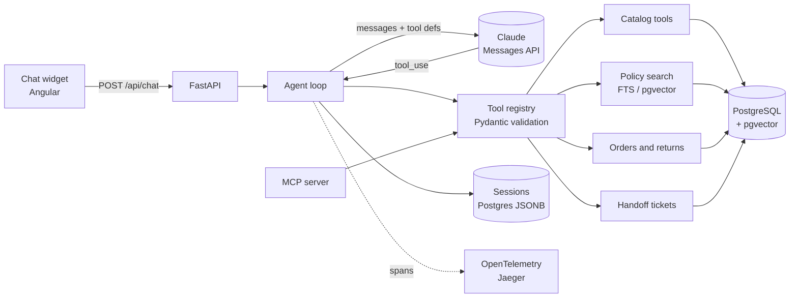

# Phase 0: Design

## Goal

Agree on the architecture before writing code, create the repository skeleton and record the
first decisions.

## The core idea in one paragraph

A customer-support agent is a **loop around a language model**. The model reads the
conversation and either answers or asks to call a *tool* (a function we expose, such as
"check stock"). Our code validates the request, runs the function against the store's
database and sends the result back. The model never touches the database: **it proposes,
the code decides**. Most of the engineering lives in the tools (what they accept, what they
refuse, what they return) and in measuring the behaviour with an evaluation suite.

## Architecture



## Changes proposed to the starting architecture

| # | Starting point | Change | Why |
|---|----------------|--------|-----|
| 1 | Small model to classify intent, large model to reason | One model runs the loop; Haiku is compared through evals | Tool choice already is intent classification; a router adds a round trip and a new failure class ([ADR 0003](../decisions/0003-model-strategy.md)) |
| 2 | Return tool "asks for confirmation" | Two-phase call with a confirmation token that is only redeemable in a **later user turn** | The prompt cannot guarantee confirmation; code can ([ADR 0010](../decisions/0010-two-phase-confirmation.md)) |
| 3 | `get_order_status` requires order and email | Plus: verification is bound to the session; returns only work on verified orders; same error for wrong email and missing order; lock after repeated failures | Prevents enumeration and cross-customer access even if the model is tricked |
| 4 | Conversation per session | Sessions persisted in Postgres with optimistic locking | Survives restarts and multiple API replicas |
| 5 | Size recommendation tool | Deterministic algorithm in code; the model only explains the result | Numbers must not depend on model reasoning |
| 6 | Stock check | Return stock *levels* (in stock / low / out), not raw counts | Business information leakage; customers do not need exact counts |
| 7 | MCP server with the same tools | Expose read-only tools only | Confirmation semantics for writes belong to the MCP host; documented in [ADR 0014](../decisions/0014-mcp-read-only.md) |
| 8 | Evaluation | Deterministic graders first; LLM-as-judge only for tone and language | Cheaper, reproducible, debuggable |
| 9 | Dates | A configurable store clock (`STORE_TODAY`) | Return-window logic and evals must be reproducible |

## Repository layout

```
data/            synthetic data generator, generated JSON, policies (Markdown)
db/migrations/   SQL schema
src/quilora/     application code (tools, agent, search, api, mcp)
evals/           evaluation cases, runner, baseline
tests/           unit and integration tests
web/             Angular chat widget
docs/            ADRs, phase notes, results, interview material
```

## How to verify this phase

- `git status` shows no `.env`; `scripts/check_secrets.sh` passes.
- The ADR index lists the decisions above.
