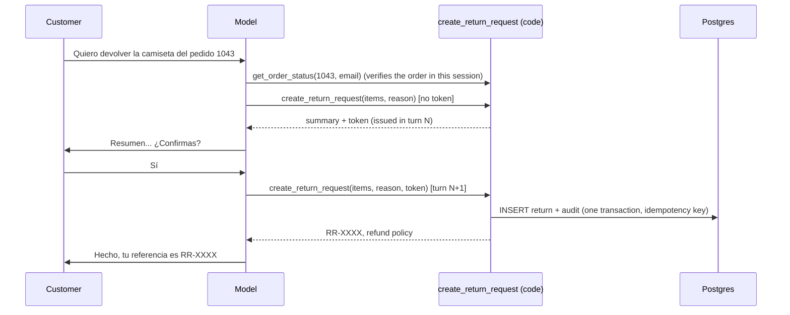

# Phase 5: Actions with confirmation (returns and handoff)

_Author: Ignacio Rodríguez Caro_

## Concept

Reading data is low risk; **changing** it is not. For actions with side effects, an agent
needs three guarantees that a prompt cannot give:

1. **Authorisation**: is this customer allowed to act on this order?
2. **Consent**: did the customer explicitly agree to *this* action?
3. **Idempotency**: if the call is repeated (retry, double click, model loop), does it
   happen once?

We put all three in code. The model proposes; the tool decides.

## What was built

| File | Responsibility |
|------|----------------|
| `db/migrations/003_*.sql` | `return_requests` (unique idempotency key), `support_tickets` (one open per session), `audit_log` |
| `tools/returns.py` | Two-phase `create_return_request` |
| `tools/handoff.py` | Idempotent `handoff_to_human` with forced priority for money disputes |
| `agent/prompts/system.md` | Return procedure and handoff rules |

## The return flow



If the model tries to redeem the token in the same turn, the tool answers
`CONFIRMATION_NEEDS_CUSTOMER_REPLY` (covered by `test_model_cannot_confirm_within_the_same_turn`).

## Rules enforced by code (and tested)

- Return only on an order verified in this session (`ORDER_NOT_VERIFIED`).
- Items must belong to the order, be eligible and within quantity
  (`ITEM_NOT_IN_ORDER`, `ITEM_NOT_RETURNABLE` with the reason, `QUANTITY_TOO_HIGH`).
- Defective or wrong items go to a person (`USE_HANDOFF`), as the policy says.
- Token: same session, not expired, later turn, same items and reason.
- Replays return the same return ID; concurrent duplicates are stopped by a unique key.
- Handoff: one open ticket per conversation; complaints and money disputes are `high`.

## How to verify

```bash
make test   # tests/test_actions.py
```

Manually: in `make chat`, ask to return the T-shirt of order 1043 (email
`lucia.romero@example.com`), answer "sí" to the summary, then ask to return it again.
